# Loobly

A friendly, private poo and gut-health tracker for Android. Log stools (Bristol scale), meals, heartburn, water, mood and medicines, and let Gus the bean spot patterns.

- **Local-first:** all data stays on your phone in an encrypted database. No account needed.
- **Status:** in development (MVP).
- **Website:** [loobly.ie](https://loobly.ie)

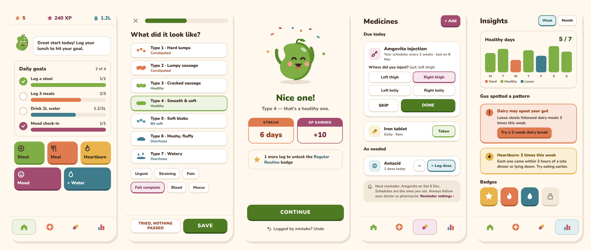

> Loobly is not a medical device and does not give medical advice. Always talk to your GP or pharmacist about symptoms and medicines.

## Screens

These are design mockups from the wireframes; the app itself is being built sprint by sprint, so the real screens may differ.

| Today | Log a stool | Log a meal | Heartburn |
|:---:|:---:|:---:|:---:|
| 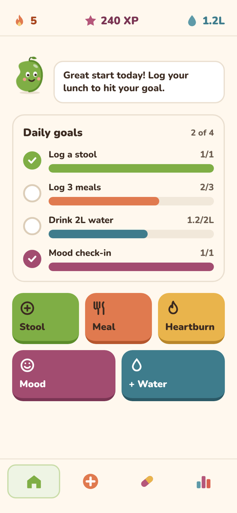 | 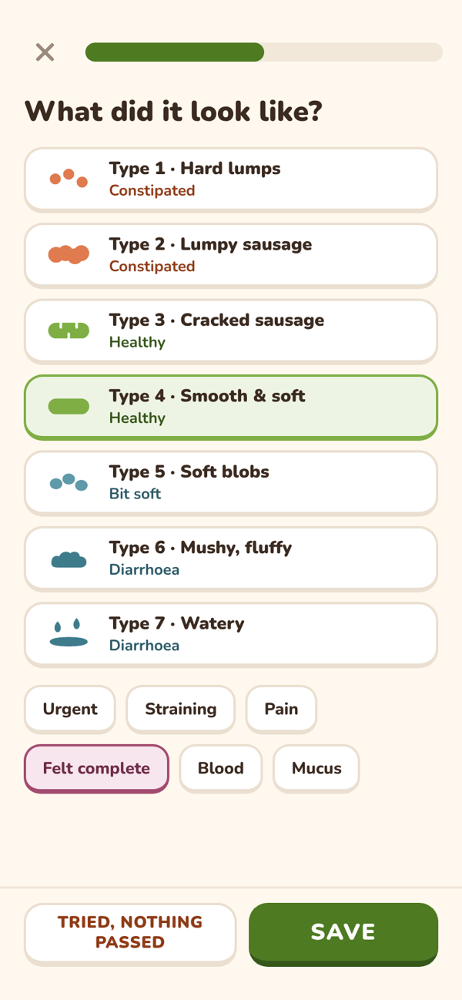 | 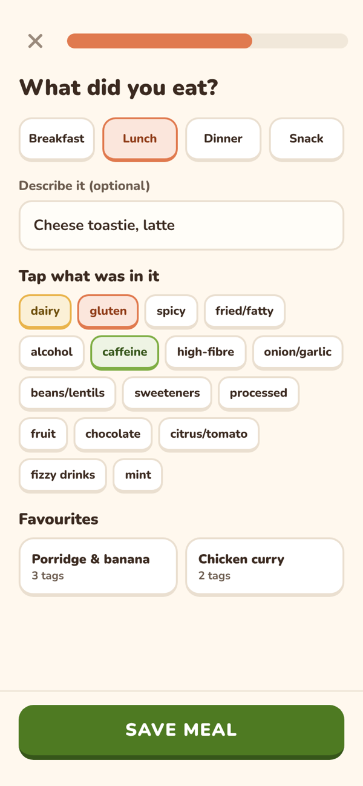 | 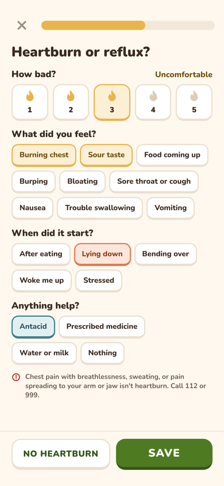 |
| **Check-in** | **Saved** | **Medicines** | **Insights** |
| 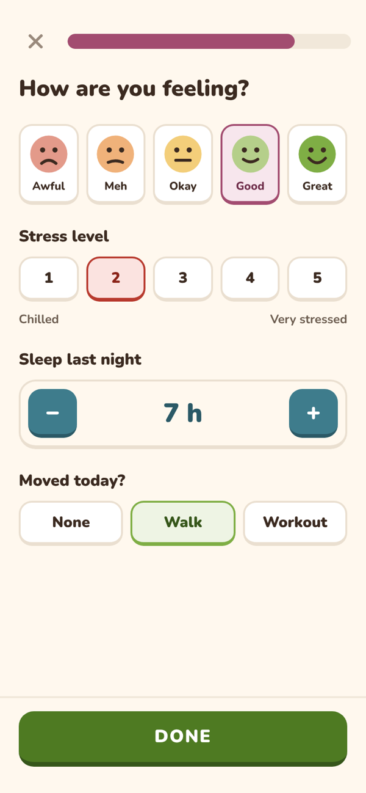 | 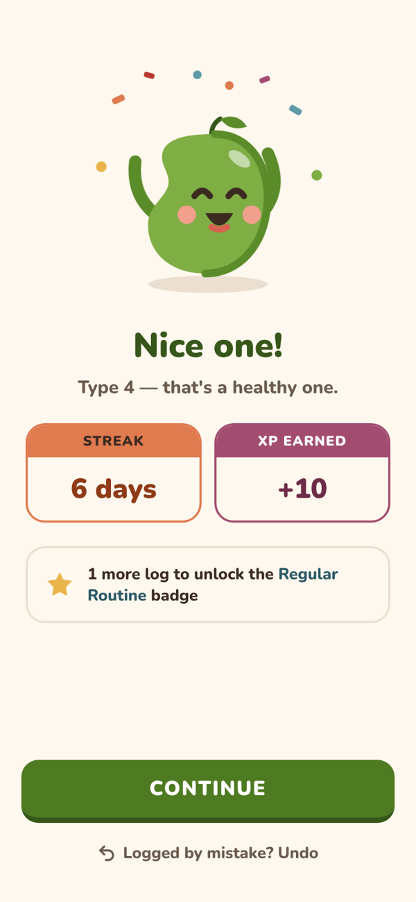 | 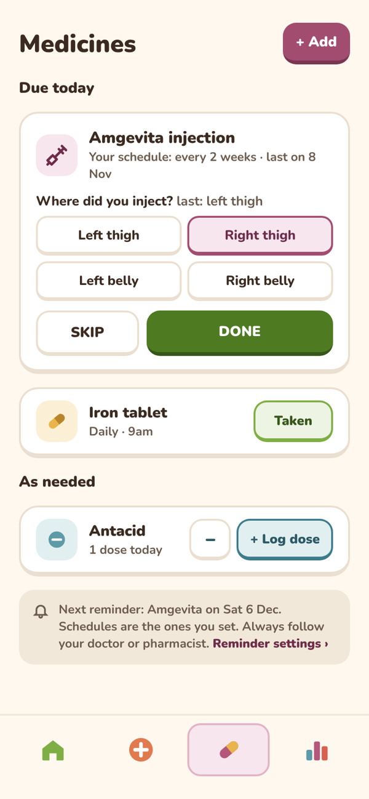 | 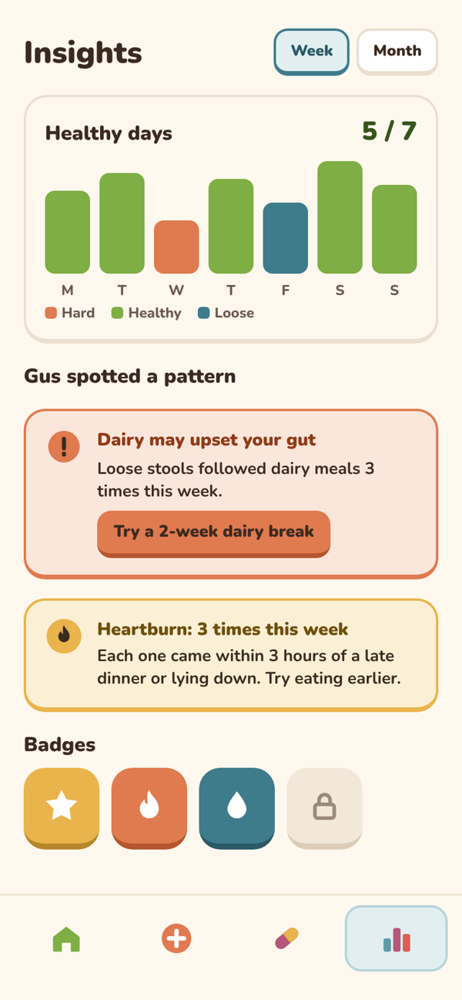 |

<b>Onboarding and reminders</b>

| Welcome | Age | Habits | Symptoms |
|:---:|:---:|:---:|:---:|
|  | 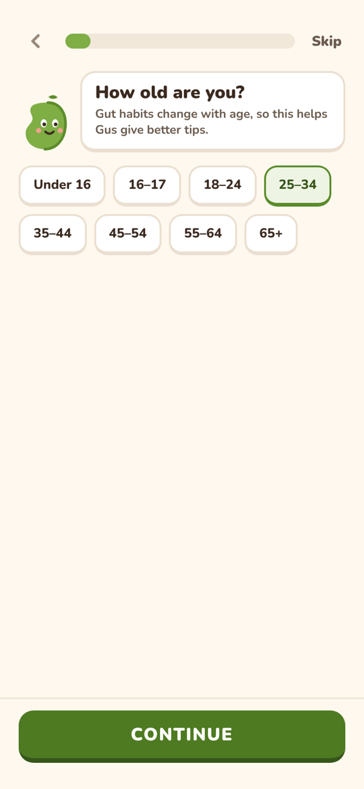 | 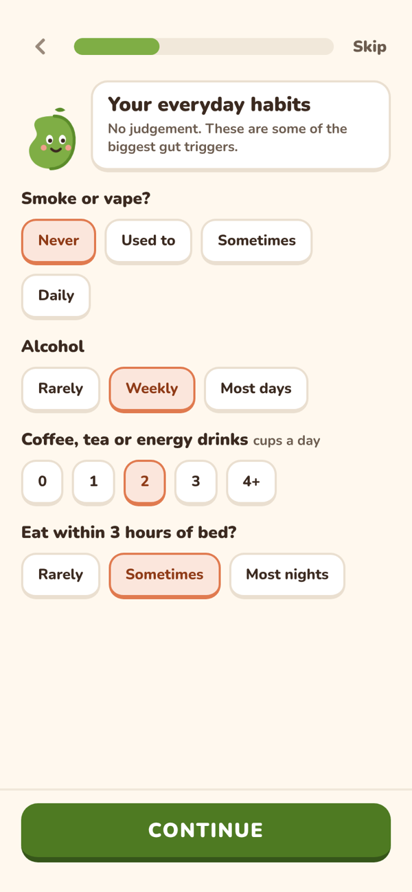 | 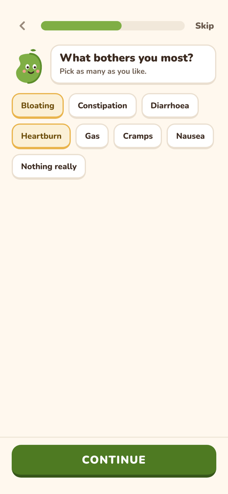 |
| **Goal** | **Privacy** | **Reminders** | |
| 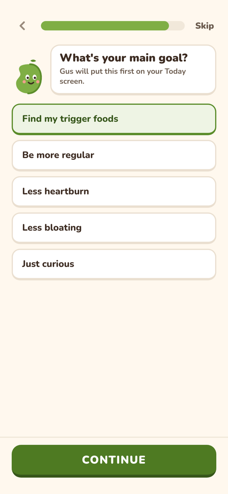 | 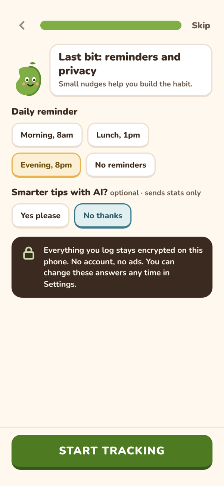 | 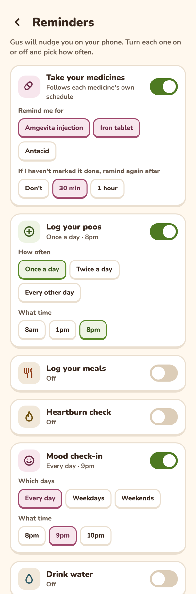 | |

<b>Landing page and architecture</b>

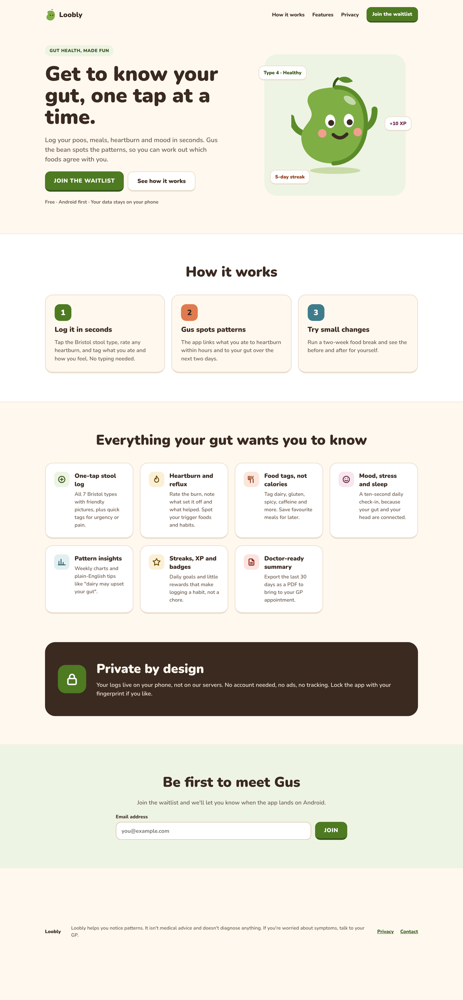

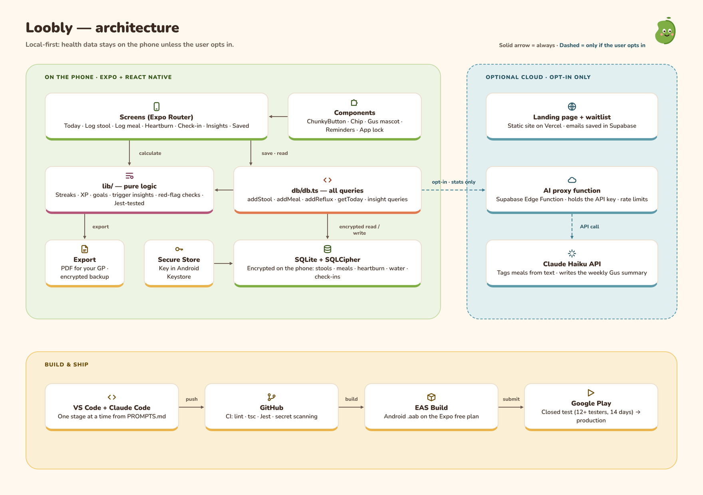

## Tech stack

Expo (React Native) · TypeScript · Expo Router · expo-sqlite (SQLCipher) · Reanimated · expo-notifications · Jest · Maestro · GitHub Actions · EAS Build

## Getting started

The app hasn't been created yet: this repo currently holds the project docs, backlog templates and workflow. Getting-started steps will be added once the Expo app is set up (Sprint 1).

## How work is organised

- **Backlog and sprints:** [Issues](https://github.com/DublinNico/loobly-gut-tracker/issues) are user stories, grouped into two-week [Milestones](https://github.com/DublinNico/loobly-gut-tracker/milestones) (sprints) and tracked on the Loobly project board.
- **Branches:** one per story, e.g. `feature/FR-01-log-stool`, merged into a protected `main` through a pull request.
- **Releases:** tagged `vMAJOR.MINOR.PATCH` with a [CHANGELOG](CHANGELOG.md) entry.

Details in [CONTRIBUTING](CONTRIBUTING.md).

## Project docs

- [Architecture](docs/architecture.md)
- [Architecture decisions (ADRs)](docs/adr/)
- [Definition of Ready](docs/definition-of-ready.md) · [Definition of Done](docs/definition-of-done.md)
- [Testing](docs/testing.md)
- [Contributing and branching](CONTRIBUTING.md)
- [Changelog](CHANGELOG.md)

## Licence

See [LICENSE](LICENSE).
